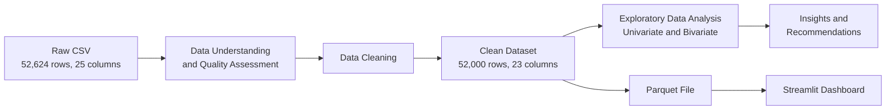
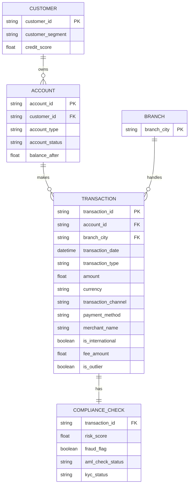
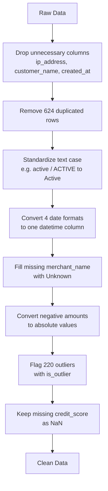
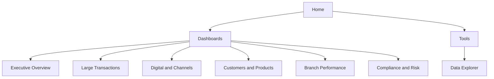

# Finance & Banking Transactions Analysis


[](https://finance-banking-dashboard.streamlit.app)

An end-to-end data analysis project on **52,000 banking transactions of a German bank (2022–2025)**. The project covers data quality assessment, data cleaning, exploratory data analysis and an interactive multi-page **Streamlit dashboard** built for each stakeholder of the bank.

> This project was completed as the **Mid Project** of the Data Analysis track at **Epsilon AI**.
> Main Epsilon AI repository: [Epsilon AI](https://github.com/gtaha3-cyber/Epsilon-AI-repo)

---

## Table of Contents

1. [Project Overview](#project-overview)
2. [Project Workflow](#project-workflow)
3. [Dataset](#dataset)
4. [Data Schema](#data-schema)
5. [Data Cleaning](#data-cleaning)
6. [Analysis Questions](#analysis-questions)
7. [Key Findings](#key-findings)
8. [Dashboard](#dashboard)
9. [Project Structure](#project-structure)
10. [How to Run](#how-to-run)
11. [Limitations](#limitations)

---

## Project Overview

The goal of this project is to turn raw banking transaction data into clear business insights. The raw dataset contains several quality issues (duplicates, missing values, inconsistent text, mixed date formats, negative amounts and outliers), which were documented and fixed before the analysis. The cleaned data was then analyzed to answer six business questions, each linked to a specific stakeholder, and the results were presented in an interactive dashboard.

## Project Workflow



## Dataset

| Item | Value |
|---|---|
| Domain | Finance & Banking |
| Period | January 2022 – December 2025 |
| Raw size | 52,624 rows × 25 columns |
| Clean size | 52,000 rows × 23 columns |
| Branches | 15 cities in Germany |
| Currencies | EUR, USD, GBP, CHF, PLN |
| Format | CSV (raw and clean) and Parquet (used by the dashboard) |

## Data Schema

The dataset is a **single flat table** where each row is one transaction. Logically, the columns describe five related entities: the **customer**, the **account**, the **transaction**, the **branch** and the **compliance checks**. The diagram below shows this logical schema of the clean dataset.



### Column Dictionary (Clean Dataset)

| Column | Type | Description |
|---|---|---|
| `transaction_id` | Text | Unique identifier of the transaction |
| `account_id` | Text | Identifier of the account that made the transaction |
| `customer_id` | Text | Identifier of the customer who owns the account |
| `account_type` | Categorical | Checking, Savings, Credit Card, Loan, Mortgage, Investment |
| `account_status` | Categorical | Current status of the account: Active, Dormant, Frozen, Closed |
| `transaction_type` | Categorical | Deposit, Withdrawal, Transfer, Payment, Refund, Fee, Interest |
| `transaction_date` | Date | Date of the transaction (2022-01-01 to 2025-12-31) |
| `amount` | Numerical | Size of the transaction (absolute value) |
| `currency` | Categorical | EUR, USD, GBP, CHF, PLN |
| `balance_after` | Numerical | Account balance after the transaction |
| `transaction_channel` | Categorical | Online, Mobile App, ATM, Branch, Phone, SEPA, Direct Debit |
| `branch_city` | Categorical | One of 15 German cities |
| `merchant_name` | Categorical | Merchant or beneficiary ("Unknown" if missing) |
| `payment_method` | Categorical | Debit Card, Credit Card, Bank Transfer, SEPA, Cash |
| `is_international` | Boolean | Whether the transaction crossed borders |
| `fee_amount` | Numerical | Fee charged by the bank (0 to 25) |
| `risk_score` | Numerical | Automated risk rating (0 to 100) |
| `fraud_flag` | Boolean | Whether the transaction was flagged as fraud |
| `aml_check_status` | Categorical | Anti-Money Laundering check: Passed, Failed, Pending, Manual Review, Skipped |
| `kyc_status` | Categorical | Know Your Customer status: Verified, Pending, Expired, Not Required |
| `credit_score` | Numerical | Customer creditworthiness (300 to 850, about one third missing) |
| `customer_segment` | Categorical | Retail, Premium, Private Banking, Business, Corporate |
| `is_outlier` | Boolean | New column: whether the amount is an outlier (IQR method) |

## Data Cleaning



| Issue | Action | Result |
|---|---|---|
| Unnecessary columns | Dropped `ip_address`, `customer_name`, `created_at` | 25 to 22 columns |
| Duplicated rows | Removed | 624 rows removed |
| Inconsistent text case | Standardized 4 columns | One form for each value |
| Mixed date formats stored as text | Parsed each format and converted to `datetime` | 0 dates lost |
| Missing `merchant_name` | Filled with "Unknown" | 7,165 values filled |
| Random negative amounts | Absolute value | 25,890 values converted |
| Outliers in `amount` | Kept and flagged with `is_outlier` | 220 outliers flagged |
| Missing `credit_score` | Kept as NaN | Not filled on purpose |
| Multiple currencies | Analysis based on transaction counts | No conversion |

## Analysis Questions

| # | Question | Stakeholder |
|---|---|---|
| Q1 | How did the number of transactions and active customers change from 2022 to 2025? | Executive Management |
| Q2 | Where do large transactions come from, and are they well controlled? | Relationship Managers |
| Q3 | How do customers use digital and non-digital channels, and is digital usage growing? | Digital & Product Team |
| Q4 | Which products does each customer segment use? | Marketing Team |
| Q5 | Which branch cities are growing and which are declining? | Branch Operations |
| Q6 | How many transactions have compliance red flags, and does the risk score identify fraud? | Compliance Team |

## Key Findings

- Transactions and active customers are **stable at about 13,000 per year**, with a small decline of about 1% in 2024 and 2025.
- **Large transactions** are rare (0.42%), and about half of them are linked to accounts that are now Frozen, Dormant or Closed.
- **Digital channels** handle only **28.9%** of transactions and are not growing, while Branch is the only growing channel (+11.6%).
- All customer segments use the 6 products in **almost equal shares**, so products are not tailored to each segment.
- **10 of 15 branches** declined from 2022 to 2025.
- **73.1%** of transactions have at least one compliance red flag, and the **risk score does not identify fraud**.

## Dashboard

**Live app:** [finance-banking-dashboard.streamlit.app](https://finance-banking-dashboard.streamlit.app)

The Streamlit dashboard has a dedicated page for each stakeholder, with sidebar filters (currency and customer segment) that apply to all pages.



| Page | Content |
|---|---|
| Home | Overview of the dashboards and notes about the data |
| Executive Overview | Yearly KPIs compared with the previous year, yearly and monthly trends |
| Large Transactions | Where large transactions come from and how well they are controlled |
| Digital & Channels | Digital vs non-digital usage and the growth of each channel |
| Customers & Products | Product mix per customer segment |
| Branch Performance | Branch map, growth by branch and branch details |
| Compliance & Risk | Red flags, KYC vs AML and an interactive risk score test |
| Data Explorer | Search, filter and download the transactions |

## Project Structure

```
├── Finance & Banking Mid Project Analysis.ipynb   # Data understanding, cleaning, EDA and conclusion
├── Streamlit Notebook.ipynb                        # Prepares the clean data for the dashboard
├── Cleaning_Notes.txt                              # Summary of all cleaning steps
├── finance_banking_transactions_2022_2025.csv      # Raw dataset
├── finance_banking_transactions_clean.csv          # Clean dataset
├── finance_banking_transactions_clean.parquet      # Clean dataset used by the dashboard
├── app.py                                          # Streamlit app: data loading, filters and navigation
├── pages/                                          # One file for each dashboard page
├── .streamlit/config.toml                          # Dashboard theme
└── requirements.txt                                # Required libraries
```

## How to Run

The dashboard is available online at the link above. To run it locally:

```bash
# activate your own virtual environment, then:
pip install -r requirements.txt
streamlit run app.py
```

## Limitations

The dataset is **synthetic**: the fraud rate is about 50%, categories are almost equally distributed, the amounts have the same distribution in all 5 currencies and every transaction has a different account. Therefore, the analysis is based on **transaction counts** instead of values, and the findings demonstrate the analysis approach rather than the behavior of a real bank.

---

**Author:** Ghada